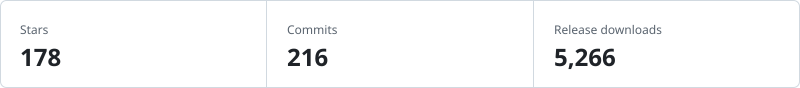
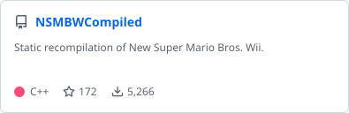
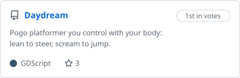
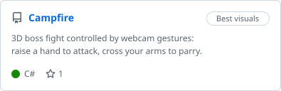
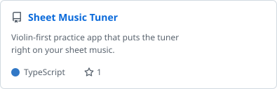

<h1 align="center">Hi there 👋, I'm Ryan!</h1>

Port Moody Secondary School · Grad 2027

  <picture>
    <source media="(prefers-color-scheme: dark)" srcset="./stats-dark.svg">
    
  </picture>

<h3 align="center">Featured projects</h3>

  <a href="https://github.com/ral1009/NSMBWiicompiled"><picture><source media="(prefers-color-scheme: dark)" srcset="./cards/NSMBWiicompiled-dark.svg"></picture></a>
  <a href="https://github.com/ral1009/daydream"><picture><source media="(prefers-color-scheme: dark)" srcset="./cards/daydream-dark.svg"></picture></a>
   
  <a href="https://github.com/ral1009/campfire"><picture><source media="(prefers-color-scheme: dark)" srcset="./cards/campfire-dark.svg"></picture></a>
  <a href="https://github.com/ral1009/tunerapp"><picture><source media="(prefers-color-scheme: dark)" srcset="./cards/tunerapp-dark.svg"></picture></a>

**Languages and Tools:**

